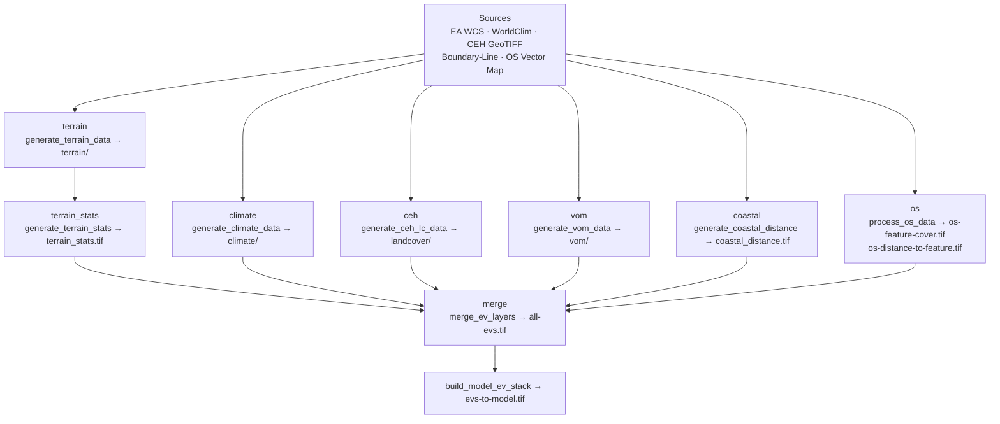

# Rebuild environmental layers

## Command

```bash
sdm data --output-dir <folder>
```

Alias: `sdm data -o <folder>`.

### Flags

| Flag | Purpose |
|------|---------|
| `--output-dir` / `-o` | **Required** unless `--plan`. Local folder for rebuilt layers (string, so `gs://` is not collapsed by pathlib). |
| `--plan` | Print each step, source URL or local path, whether that input is present, and OS 100 km tiles. No downloads, no writes. Exits non-zero if required CEH LCM 2023 10 m GeoTIFF is missing (unless `ceh` is skipped). |
| `--cache-dir` | Download caches (WorldClim, OS tiles + parquets, Boundary-Line). Default: `<output-dir>/cache`. |
| `--fresh` | Ignore stale OS parquet and Boundary-Line caches; rebuild them from sources under `--cache-dir`. |
| `--skip` | Comma-separated registry step names to skip (e.g. `--skip ceh,coastal`). Valid names: `terrain`, `terrain_stats`, `climate`, `ceh`, `vom`, `coastal`, `os`, `merge`. Unknown names exit 2 and list valid names. |
| `--only` | Comma-separated registry step names to run exclusively (same names as `--skip`). Mutually exclusive with `--skip`. |
| `--ceh-path` | Manual CEH LCM 2023 10 m GeoTIFF (default: git-ignored path under `data/raw/big-files/CEH/`). |
| `--no-live-download` | Offline mode for live OS / Boundary-Line downloads. |
| `--verbose` | Verbose logging. |

Examples:

```bash
sdm data --plan
sdm data --output-dir data/evs-rebuild
sdm data -o /tmp/evs-smoke --skip ceh,coastal
sdm data -o /tmp/x --skip ceh,coastal --plan
sdm data -o data/evs-rebuild --ceh-path /path/to/gblcm2023_10m.tif
sdm data -o data/evs-rebuild --cache-dir /tmp/evs-cache --fresh
```

This is the single documented entry point that rebuilds every environmental layer from the public/live sources wired in the data-prep modules, merges them to `<folder>/all-evs.tif`, then builds `<folder>/evs-to-model.tif` (rename → layer clipping → selected subset → multiscale neighbourhoods).

### Study-area land clip (#78)

Layer builders buffer the study boundary (default 7 km) for neighbourhood / distance edge effects, then **clip the buffered extent to land** using OS Boundary-Line mean high water (CODE 0071). That keeps the inland buffer while dropping seaward cells over the North Sea and Humber estuary. The same land clip applies when creating the study boundary (`sdm setup`). Re-run `sdm setup` and a full `sdm data` rebuild into a **separate** output folder after pulling this change; do not overwrite the live EV set.

## Ordered steps



Execution order (registry / `--skip` names for steps 1–8; model stack always follows a successful merge):

1. `terrain` — `generate_terrain_data` → `<folder>/terrain/`
2. `terrain_stats` — `generate_terrain_stats` → `<folder>/terrain_stats.tif`
3. `climate` — `generate_climate_data` → `<folder>/climate/` (WorldClim cache under `--cache-dir`/worldclim)
4. `ceh` — `generate_ceh_lc_data` → `<folder>/landcover/` (unless skipped; **manual** CEH LCM 2023 10 m GeoTIFF)
5. `vom` — `generate_vom_data` → `<folder>/vom/`
6. `coastal` — `generate_coastal_distance` → `<folder>/coastal_distance.tif` (unless skipped; Boundary-Line under `--cache-dir`/boundary-line). Optional BGS GeoCoast shapefile for a like-for-like coastal layer: `data/raw/big-files/BGS GeoCoast/GeoCoast_v1_Authority_Area_Inundation.shp`
7. `os` — `process_os_data` → `<folder>/os-feature-cover.tif`, `os-distance-to-feature.tif` (OS raw + parquets under `--cache-dir`)
8. `merge` — `merge_ev_layers` → `<folder>/all-evs.tif`
9. `build_model_ev_stack` → `<folder>/evs-to-model.tif` (notebook feature-engineering order: rename → clip → subset → multiscale)

### Model stack build settings

Configured under `ev_stack` in `config.yml` and copied into `rebuild_metrics.json` as `build_settings`:

- Selected variables: `data/ev_clusters_selected.csv` (`include == 1`)
- Multiscale groups: `ceh_landcover`, `os_cover_water`, `vom_vegetation_height` at windows 10/20/30 cells (500/1000/1500 m at 100 m resolution). CEH 500/1000/1500 m neighbourhood averages use the 1%-of-range rule following the architecture review.
- Layer clipping **ON** by default following the architecture review: coast / building / major-road distances 0–7000 m; curvature 5–95% quantiles. Disabling clipping is out of scope for #38. Concrete clip bounds (including resolved curvature 5%/95% values) are stored under `build_settings.layer_clipping.applied`.
- Per-model feature lists: **18** `data/sdm_config/*/variables_config.yml` files (not 33).

## Write guards (refused destinations)

The command exits with code 2 and does not write if `--output-dir` is:

- the current model EV directory `data/evs` (or any path under it)
- any local path whose resolved parts include an `inputs` segment
- anything under `INPUT_DATA_ROOT` when that environment variable is set
- a `gs://…` URI (including pathlib-collapsed `gs:/…` and bucket `…/inputs` paths) — rebuild writes are local only

Choose a separate folder (for example `data/evs-rebuild` or a dated path) so the published / training layer set stays unchanged.

## Metrics

Each successful (or partially failed) run writes:

- `<folder>/rebuild_metrics.json`
- `<folder>/rebuild_metrics.csv`

Columns / fields: `step`, `duration_seconds`, `peak_rss_bytes` (per-step process-tree peak via sampling), `status`, `error`. JSON also includes `build_settings` (selected CSV, multiscale windows, configured clip limits, and `layer_clipping.applied` with concrete curvature 5%/95% values) and `provenance` (git commit SHA; OS product release version/date from the Downloads API; Environment Agency dataset name + fetch time; CEH local path mtime).

## Using the rebuilt stack

```bash
sdm train --ev-file data/evs-rebuild/evs-to-model.tif
sdm predict --ev-path data/evs-rebuild/evs-to-model.tif
```

Or end-to-end after `sdm setup`:

```bash
sdm pipeline --output-dir data/evs-rebuild --fresh
```

## Implementation notes

Supports comparing a fresh rebuild against the live set without overwriting it. Layer comparison tooling and distance-geometry fixes are tracked separately. Use `--fresh` when source tiles change so stale OS parquets cannot hide updates.
